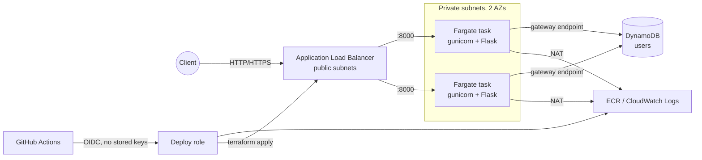

# Hello Birthday API: Flask on AWS ECS Fargate

[](https://github.com/sagary2j/python-flask-hello-world/actions/workflows/ci-cd.yml)

A small Flask API that stores a user's date of birth and greets them with a
countdown to their next birthday. It is deployed to **AWS ECS Fargate** behind an
Application Load Balancer, with **DynamoDB** for storage, **Terraform** for
infrastructure and **GitHub Actions + OIDC** for keyless continuous delivery.

## API

| Method | Path | Body | Success | Errors |
| --- | --- | --- | --- | --- |
| `PUT` | `/hello/<username>` | `{"dateOfBirth": "YYYY-MM-DD"}` | `204 No Content` | `400` invalid username/body/date, `503` storage unavailable |
| `GET` | `/hello/<username>` | none | `200 {"message": ...}` | `400` invalid username, `404` unknown user, `503` storage unavailable |
| `GET` | `/health` | none | `200 {"status": "ok"}` | none |

Rules:

- `username` must contain letters only.
- `dateOfBirth` must be a valid `YYYY-MM-DD` date strictly before today.
- People born on 29 February celebrate on 28 February in non-leap years.

```console
$ curl -X PUT localhost:8000/hello/alice -H 'Content-Type: application/json' -d '{"dateOfBirth": "1990-07-05"}'
$ curl localhost:8000/hello/alice
{"message": "Hello, alice! Your birthday is in 5 day(s)"}
$ curl localhost:8000/hello/alice   # on 5 July
{"message": "Hello, alice! Happy birthday!"}
```

All errors are JSON (`{"error": "..."}`); internal details are logged, never returned.

## Architecture



- Tasks run in private subnets with no public IP; only the ALB security group can reach them.
- The task role can only `GetItem`/`PutItem` on the `users` table.
- The service scales between 2 and 5 tasks on CPU, and failed deployments roll back automatically (ECS deployment circuit breaker).

## Repository layout

```text
app/                 Flask application (factory, routes, birthday logic, storage backends)
tests/               pytest suite (no AWS needed; DynamoDB is mocked with moto)
wsgi.py              WSGI entry point (gunicorn wsgi:app)
gunicorn.conf.py     Production server settings
Dockerfile           Multi-stage, non-root image with a health check
terraform/           Main stack: VPC, ALB, ECS Fargate, DynamoDB, IAM, autoscaling
terraform/tests/     terraform test suite with a mocked AWS provider
terraform/bootstrap/ One-time stack: GitHub OIDC provider, deploy role, ECR repository
.github/workflows/   CI/CD pipeline
```

## Local development

Requires Python 3.12+ and, optionally, Docker.

```bash
make install            # create .venv and install dev dependencies
make test               # pytest with coverage (no AWS credentials needed)
make lint               # ruff lint + format check
make run                # serve on http://127.0.0.1:8000 using a local SQLite file
```

Or run the production image:

```bash
make docker-build docker-run
```

### Configuration

| Variable | Default | Purpose |
| --- | --- | --- |
| `STORAGE_BACKEND` | `dynamodb` | `dynamodb` or `sqlite` |
| `TABLE_NAME` | `users` | DynamoDB table name |
| `AWS_REGION` | `us-east-1` | DynamoDB region |
| `DYNAMODB_ENDPOINT_URL` | unset | Point at DynamoDB Local or LocalStack |
| `SQLITE_PATH` | `users.db` | SQLite file when `STORAGE_BACKEND=sqlite` |
| `PORT` | `8000` | gunicorn listen port |
| `GUNICORN_WORKERS` / `GUNICORN_THREADS` | `2` / `4` | gunicorn concurrency |
| `LOG_LEVEL` | `INFO` | Application log level |

## CI/CD

`.github/workflows/ci-cd.yml` runs on every pull request and on pushes to `develop`:

1. **Lint and test**: ruff, then pytest (coverage must be at least 90%).
2. **Build and smoke-test image**: builds the Dockerfile, runs it, exercises the API and checks the container isn't running as root.
3. **Terraform checks**: `fmt`, `validate` for both stacks, and `terraform test` (plans with a mocked provider).
4. **Deploy** (only on the default branch, after the three jobs above pass):
   - Assumes the deploy role via OIDC.
   - Pushes the image tagged with the commit SHA.
   - Runs `terraform plan -out` followed by `terraform apply` of that saved plan.
   - Waits for the ECS service to become stable, then calls `/health` on the ALB.

Because every commit gets its own immutable image tag, each deploy registers a new
task definition and ECS performs a rolling update. Re-running a workflow reuses the
already-pushed image.

## First-time AWS setup

1. **Bootstrap** with admin credentials. This creates the OIDC provider, the deploy role and ECR:

   ```bash
   cd terraform/bootstrap
   terraform init
   # The repository already exists (created by the old setup.sh), so import it first:
   terraform import aws_ecr_repository.app flask-docker-app
   terraform apply   # add -var create_oidc_provider=false if the account already has the GitHub OIDC provider
   ```

2. In GitHub, go to **Settings > Environments**:
   - Create an environment named `production` and restrict it to the `develop` branch. Add required reviewers if you want manual approval.
   - Add a repository **variable** `AWS_DEPLOY_ROLE_ARN` set to the `deploy_role_arn` output.

3. Delete the old `AWS_ACCESS_KEY_ID` / `AWS_SECRET_ACCESS_KEY` secrets, and deactivate those IAM keys.

### Migrating from the previous ECS-on-EC2 stack

The main stack reuses the same state file. `moved` blocks keep the VPC, subnets,
first NAT gateway and the `users` table in place, so **no data is lost**. The old
EC2 cluster, ASG, launch configuration, ALB and IAM roles are destroyed and
replaced by the Fargate equivalents.

The deploy role can only manage IAM roles prefixed with `flask-hello-world-`, so the
old roles (`ecs_service_role`, `ec2_role`, `autoscaling_role`) can't be deleted by CI.
Run that one migration apply locally with admin credentials:

```bash
cd terraform
terraform init
terraform plan -var image_tag=<commit-sha-already-in-ECR> -out=tfplan   # review it
terraform apply tfplan
```

### HTTPS

Pass an ACM certificate ARN (`-var certificate_arn=arn:aws:acm:...`). The ALB then
serves TLS 1.2/1.3 on 443 and redirects port 80 to it.

## Tear down

```bash
cd terraform
terraform apply -var image_tag=<tag> -var dynamodb_deletion_protection=false
terraform destroy -var image_tag=<tag>
cd bootstrap && terraform destroy    # ECR must be empty, or delete images first
```

The S3 state bucket `terrforms3-remote-backend` is not managed here; delete it manually if no longer needed.
